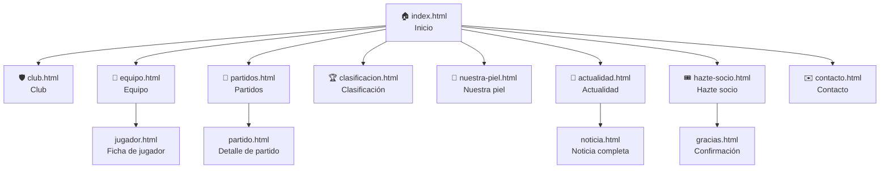

# 🗺️ Estructura del sitio

## Mapa del sitio (Site Map)



## Menú principal

| Posición | Enlace | Archivo |
|---|---|---|
| 1 | Inicio | `index.html` |
| 2 | Club | `club.html` |
| 3 | Equipo | `equipo.html` |
| 4 | Partidos | `partidos.html` |
| 5 | Clasificación | `clasificacion.html` |
| 6 | Nuestra piel | `nuestra-piel.html` |
| 7 | Actualidad | `actualidad.html` |
| 8 | **Hazte socio** (botón destacado en verde lima) | `hazte-socio.html` |

`Contacto` se enlaza desde el **pie de página** de todas las páginas.

---

## Árbol de carpetas

```
byte-city/
├── index.html
├── club.html
├── equipo.html
├── jugador.html
├── partidos.html
├── partido.html
├── clasificacion.html
├── nuestra-piel.html
├── actualidad.html
├── noticia.html
├── hazte-socio.html
├── gracias.html
├── contacto.html
├── css/
│   ├── reset.css
│   ├── base.css          ← colores, tipografías
│   ├── layout.css        ← Flexbox / Grid
│   └── responsive.css    ← @media (Mobile First)
├── img/
│   ├── logo/
│   ├── jugadores/
│   ├── equipaciones/
│   ├── estadio/
│   ├── noticias/
│   ├── aficion/
│   └── iconos/
├── docs/
│   ├── 01-planificacion.md
│   ├── ...
│   ├── mockups/          ← móvil y escritorio
│   └── validacion/       ← capturas del validador W3C
└── README.md
```

---

<div align="center">

[⬅️ Planificación](01-planificacion.md) · [📚 Índice](../README.md#-documentación) · [Guía de estilo ➡️](03-guia-de-estilo.md)

</div>
