# 🗺️ Estructura del sitio

Sitemap y organización de contenidos del sitio web oficial de **Byte City FC**.

## Mapa del sitio (Site Map)

```mermaid
flowchart TD
    A[🏠 index.html<br>Inicio] --> B[🛡️ pages/club.html<br>Club]
    A --> C[👥 pages/equipo.html<br>Equipo]
    A --> D[📅 pages/partidos.html<br>Partidos]
    A --> E[👕 pages/nuestra-piel.html<br>Nuestra piel - Tienda]
    A --> F[📰 pages/actualidad.html<br>Actualidad]
    A --> G[🎟️ pages/hazte-socio.html<br>Hazte socio]
    A --> H[✉️ pages/contacto.html<br>Contacto]
    A --> I[⚖️ pages/legal.html<br>Aviso legal]

    B --> B1[#historia<br>Historia y fotos]
    B --> B2[#estadio<br>Fotos, año y ubicación]
    B --> B3[#aficion<br>Peñas y contador de socios]

    C --> C1[Porteros / Defensas / Medios / Delanteros]
    C --> C2[Entrenador y 2º Entrenador]

    D --> D1[4-5 Partidos recientes<br>Matchdays / Tablas]

    E --> E1[Equipaciones 1ª, 2ª y 3ª]
    E --> E2[Merchandising balones, gorras...]
    E --> E3[Ficha producto con fotos y descripción]

    F --> F1[Noticias con fotos y texto completo]

    G --> G1[Página estática<br>3 Cuotas y beneficios]

    H --> H1[Email, teléfono, RRSS y disclaimer]
    I --> I1[Aviso legal y créditos]
```



## Menú principal

| Posición | Enlace | Tipo | Destino | Contenido / Secciones |
|:-:|---|---|---|---|
| 1 | **Inicio** | Enlace | `index.html` | Portada, hero con lema, próximo partido y resumen |
| 2 | **Club** | Desplegable (CSS) | `pages/club.html` | Enlaces ancla: `#historia`, `#estadio`, `#aficion` |
| 3 | **Equipo** | Enlace | `pages/equipo.html` | Porteros, Defensas, Medios, Delanteros y Cuerpo técnico |
| 4 | **Partidos** | Enlace | `pages/partidos.html` | 4–5 partidos recientes (matchdays o tablas de resultados) |
| 5 | **Nuestra piel** | Enlace | `pages/nuestra-piel.html` | Tienda: 3 equipaciones, merchandising y detalle de producto |
| 6 | **Actualidad** | Enlace | `pages/actualidad.html` | Noticias con fotos y texto completo |
| 7 | **Hazte socio** | Botón destacado (lima) | `pages/hazte-socio.html` | 3 cuotas con precios y beneficios (página estática) |

> `Contacto` y `Aviso legal` se enlazan principalmente desde el **pie de página** (`<footer>`) de todo el sitio web.

---

## Estructura del proyecto

```text
byte-city-fc/
├── README.md
├── index.html                 <-- Portada principal en la raíz
├── css/
│   └── base.css               <-- Paleta, tipografías y estilos base
├── pages/                     <-- Páginas interiores del sitio
│   ├── club.html              <-- Historia, estadio y afición (peñas y contador)
│   ├── equipo.html            <-- Jugadores por posición + cuerpo técnico
│   ├── partidos.html          <-- 4-5 partidos recientes en matchdays/tablas
│   ├── nuestra-piel.html      <-- Tienda: equipaciones y merchandising
│   ├── actualidad.html        <-- Noticias con fotos y texto
│   ├── hazte-socio.html       <-- Página estática con 3 cuotas y beneficios
│   ├── contacto.html          <-- Teléfono, email, RRSS y disclaimer
│   └── legal.html             <-- Aviso legal
├── docs/
│   ├── 01-planificacion.md ... 08-referencias-de-diseno.md
│   ├── mockups/
│   └── validacion/
└── img/
    ├── aficion/
    ├── codeunitedfc/
    ├── equipaciones/
    │   ├── Primera equipacion/
    │   ├── Segunda equipacion/
    │   └── Tercera equipacion/
    ├── escudo/
    ├── estadio/
    ├── jugadores/
    ├── logo/
    ├── noticias/
    └── ropa/
```

---

<div align="center">

[⬅️ Planificación](01-planificacion.md) · [📚 Índice](../README.md#-documentación) · [Guía de estilo ➡️](03-guia-de-estilo.md)

</div>
