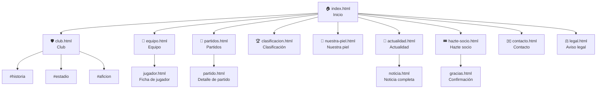

# 🗺️ Estructura del sitio

> El sitemap describe el **alcance previsto**. Actualmente solo está implementada `html/index.html`; las demás páginas enlazadas son todavía pendientes. La estructura real de carpetas se muestra más abajo.

## Mapa del sitio (Site Map)



## Menú principal

| Posición | Enlace | Tipo | Destino |
|:-:|---|---|---|
| 1 | Inicio | Enlace | `index.html` |
| 2 | Club | **Desplegable** | `club.html` → Historia, Estadio, Afición (anclas) |
| 3 | Equipo | Enlace | `equipo.html` |
| 4 | Partidos | Enlace | `partidos.html` |
| 5 | Clasificación | Enlace | `clasificacion.html` |
| 6 | Nuestra piel | Enlace | `nuestra-piel.html` |
| 7 | Actualidad | Enlace | `actualidad.html` |
| 8 | **Hazte socio** | Botón destacado en verde lima | `hazte-socio.html` |

El desplegable de «Club» se puede hacer solo con CSS (`:hover` y `:focus-within`), sin JavaScript.

`Contacto` y `Aviso legal` se enlazan desde el **pie de página** de todas las páginas.

---

## Estructura actual de carpetas

```text
byte-city-fc/
├── README.md
├── docs/
│   ├── 01-planificacion.md ... 08-referencias-de-diseno.md
│   ├── mockups/
│   └── validacion/
├── html/
│   └── index.html
└── img/
    ├── aficion/
    ├── codeunitedfc/
    ├── equipaciones/
    ├── escudo/
    ├── estadio/
    ├── jugadores/
    ├── logo/
    ├── noticias/
    └── ropa/
```

`img/codeunitedfc/` contiene el escudo del rival mostrado en el próximo partido. Los directorios de recursos sin imágenes conservan un archivo `.gitkeep`. Aún no hay una carpeta `css/` ni páginas HTML adicionales.

## Estructura prevista

La siguiente estructura es una propuesta para las siguientes fases. Las páginas y hojas CSS enumeradas aún no están creadas.

```
byte-city-fc/
├── index.html
├── club.html
├── equipo.html
├── jugador.html
├── partidos.html
├── partido.html
├── clasificacion.html
├── nuestra-piel.html
├── actualidad.html
├── noticia.html
├── hazte-socio.html
├── gracias.html
├── contacto.html
├── legal.html
├── css/
│   ├── reset.css
│   ├── base.css          ← colores, tipografías
│   ├── layout.css        ← Flexbox / Grid
│   └── responsive.css    ← @media (Mobile First)
├── img/
│   ├── logo/
│   ├── jugadores/
│   ├── equipaciones/
│   ├── estadio/
│   ├── noticias/
│   ├── aficion/
│   └── iconos/
├── docs/
│   ├── 01-planificacion.md
│   ├── ...
│   ├── mockups/          ← móvil y escritorio
│   └── validacion/       ← capturas del validador W3C
└── README.md
```

---

<div align="center">

[⬅️ Planificación](01-planificacion.md) · [📚 Índice](../README.md#-documentación) · [Guía de estilo ➡️](03-guia-de-estilo.md)

</div>
